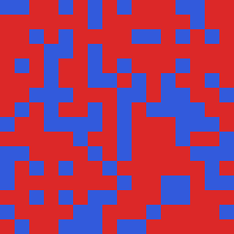
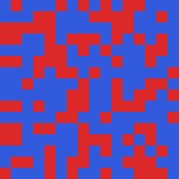

# Jev leans toward the word "blue" in close calls

*Lab note · 2026-10-04 · `jev-latest` via `api.typesafe.ai/v1/systemone`*

**The project.** At an SF swarm hackathon (Oct 3–4, 2026) we asked whether a swarm of Jev agents can coordinate when each agent's whole output is one typed choice. Every cell of a 16×16 grid is a separate Jev call that looks at its neighbours and picks a colour each frame. The canvas is the only way the cells communicate, so the swarm is a cellular automaton whose update rule is the model.

| Red majority (64% at start) → all red by frame 14 | Blue majority (59% at start) → all blue by frame 15 |
|:---:|:---:|
|  |  |

**What we saw.** Agreement is easy: boards reach consensus fast and stay there. Tasks that need cells to *differ* (hold a 50/50 split, grow a shape from a seed) never settle. In between is **[density classification](https://en.wikipedia.org/wiki/Majority_problem_(cellular_automaton))**, a classic cellular automata benchmark: every cell should end up the colour that was the majority at the start, using only local information. Hand-designed and evolved rules reach about 80% full-board success on the standard 1D version (GKL, 1978), and no 2-state rule can be perfect (Land & Belew, 1995). Zero-shot, with no training, Jev moved the board toward the right colour in 92% of our runs but made it fully unanimous in only 31%.

Looking at why so many runs stalled, we noticed red-majority boards almost never finished. That led to this note.

**The finding:** Jev favours whichever option is *named* "blue" when the evidence is balanced. Renaming the same two colours to A/B removes the effect. Renaming red to "blue" moves the effect to red.

> In 126 exactly-balanced windows, the option named "blue" gets **+7 points** of probability over its colour-swapped twin under red/blue naming, and **+5 points** when the names are swapped onto the other colour. With A/B names the gap is **0.00**.

## Setup

Each Jev call plays one cell of a grid. It sees its 3×3 neighbourhood as characters and picks one of two colours. The task is density classification: the whole board should end up the colour that was the majority at the start. This is the exact `state` string Jev received for one window (line breaks added here for width; `python probe.py --print-state` prints the real one):

```
You are one of many independent agents. Each of you controls exactly ONE cell of a
shared pixel canvas. You all act at the same time and you cannot communicate except
through the colours on the canvas.

Below is a 3x3 window around your cell. Each character is one cell's current colour;
your own cell is shown as '@'.

RBR
B@B
BBR

LEGEND: R=red  B=blue

YOURCELL: row 7, col 7 (0-indexed from top-left) of a 16x16 canvas
CURRENT: red

TASK: The canvas began as a random mix of red and blue cells. Your goal, shared by
every agent: the whole canvas should end up entirely the ONE colour that was MORE
common at the very start (the global majority). You see only your local neighbourhood,
not the whole board, so infer which colour is winning and help it take over. Choose
your colour.
```

The question is a `choice` with instructions `"Choose the colour for your cell."` and criteria `{"red":"red","blue":"blue"}`. Under the other namings, only the colour names and their letters change (R/B → A/B, Y/P, or swapped): in the window, the legend, CURRENT, the TASK sentence and the criteria. We read `probabilities` from each answer.

We sent all 512 possible windows (centre + 8 neighbours), twice each, under four namings of the same two colours. Only the words change. Every window has a colour-flipped twin, so a colour-neutral model gives P(X | window) = P(Y | flipped window). We report the average gap.

## Result

Gap between a window and its flipped twin, grouped by how many of the 9 cells are the first colour. Positive means the first-named option in the row label is favoured.

| Naming (cells X / cells Y) | 3 of 9 | 4 of 9 | 5 of 9 | 6 of 9 | Balanced windows |
|---|---:|---:|---:|---:|---|
| X="red", Y="blue" | −0.01 | **−0.07** | **−0.07** | −0.01 | 89 of 126 favour "blue" |
| X="blue", Y="red" (swap) | **+0.06** | **+0.05** | **+0.05** | **+0.06** | 87 of 126 favour "blue" |
| X="A", Y="B" | +0.07 | 0.00 | 0.00 | +0.07 | 62 of 126 favour "A" |
| X="yellow", Y="purple" | +0.06 | +0.02 | +0.02 | +0.06 | 67 of 126 favour "yellow" |

Bold entries are the ones where the option named "blue" wins. The shift is largest exactly where the evidence is balanced (4 or 5 of 9). The two runs of each window differ by 0.026 on average, much smaller than the gap. 89 of 126 under a 50/50 null is about 4.6 standard deviations.

## The full rule table (red/blue naming)

P(cell picks red), by number of red neighbours and the cell's own colour:

| red neighbours | 0 | 1 | 2 | 3 | 4 | 5 | 6 | 7 | 8 |
|---|---:|---:|---:|---:|---:|---:|---:|---:|---:|
| centre blue | .02 | .02 | .04 | .12 | .34 | .65 | .85 | .93 | .86 |
| centre red | .19 | .10 | .15 | .28 | .58 | .86 | .97 | 1.00 | .99 |

For comparison, the same table with A/B names (P(cell picks A), by A-neighbours):

| A neighbours | 0 | 1 | 2 | 3 | 4 | 5 | 6 | 7 | 8 |
|---|---:|---:|---:|---:|---:|---:|---:|---:|---:|
| centre B | .02 | .03 | .08 | .18 | .38 | .67 | .88 | .94 | .80 |
| centre A | .24 | .12 | .20 | .34 | .61 | .89 | .97 | .99 | .99 |

Apart from the bias, the rule is sensible: a soft majority vote where the cell's own colour counts for about one extra vote. One quirk: a cell completely surrounded by the other colour keeps its own colour more often (13–27%) than a cell with one ally (6–14%). That isn't monotonic, and it shows up under every naming.

## What this does and doesn't show

- One prompt and one task. We haven't checked whether the lean appears outside this grid setup, or with other colour pairs.
- The size is modest (5–7 points) and limited to close calls. Clear-cut windows are unaffected.
- The A/B and yellow/purple namings show smaller asymmetries (up to 7 points) in windows that are 3-vs-6, not at the tie. So the names matter in general. "Blue" is just the one with a consistent direction across both orderings.
- Prompt order differs between the red/blue and swap runs ("red and blue" vs "blue and red"). The blue lean shows up under both orders, so mention order doesn't explain it.

## Reproduce

Python 3.9+, standard library only. Four namings × 512 windows × 2 repeats = 4,096 calls, about $0.09 at our usage.

```sh
export TYPESAFE_API_KEY=...
python probe.py --labels rb ab yp swap --repeats 2   # writes data/<labels>.json
python analyze.py                                    # prints every number above
```

`data/` holds our original responses, so `python analyze.py` reproduces the tables without any API calls.

- `probe.py`: builds the state string for each window and calls Jev (the prompt text is identical, byte for byte, to the original swarm runs).
- `analyze.py`: the flip-gap table, balanced-pair counts, repeat noise and rule tables.
- `data/{rb,swap,ab,yp}.json`: per-window `p_red` (probability of the option the *red* cells are called), choice and confidence, two repeats each.

*Found while building a swarm-coordination experiment on Jev at an SF hackathon, October 2026. Run by Jonah with Claw (an AI assistant on Claude).*
